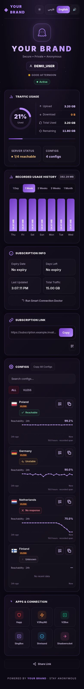

<div align="center">

# 👻 Ghost Sub

### Premium Subscription Page Template

#### 3X-UI · Pasarguard · Marzban


یه دستور. پنلت. تمت. اسم برندت.

</div>

صفحهٔ اشتراک برای **3X-UI، Marzban و Pasarguard**؛ با برند و لوگوی دلخواه، چهار رنگ، فارسی/انگلیسی و چیدمان موبایل.


## پیش‌نمایش

<table>
  <tr>
    <th>قرمز · ۱ روز</th>
    <th>سبز · ۱ هفته</th>
    <th>آبی · ۳ هفته</th>
    <th>بنفش · ۱ ماه</th>
  </tr>
  <tr>
    <td width="25%" valign="top"></td>
    <td width="25%" valign="top"></td>
    <td width="25%" valign="top"></td>
    <td width="25%" valign="top"></td>
  </tr>
</table>

## راهنمای سریع

برای نصب، دستور تک‌خطی را **روی سرور پنل** اجرا کنید؛ نه داخل PowerShell ویندوز. سپس بخش‌های لازم را از منو انتخاب کنید:

| هدف | ترتیب کار |
|---|---|
| فقط صفحهٔ ساب و لوگوی شخصی | گزینهٔ۱ ← فعال‌سازی قالب در پنل |
| تغییر برند، عکس یا رنگ | گزینهٔ۲ |
| نمودار دسترسی سرورها | گزینهٔ۴ برای جمع‌آوری ← گزینهٔ۷ برای اتصال به لینک اصلی |
| نمودار مصرف ثنایی | گزینهٔ۳ برای جمع‌آوری ← گزینهٔ۸ برای اتصال به لینک اصلی |
| نمودار مصرف Marzban/Pasarguard | نصب اختیاری Tracker در انتهای نصب ظاهر |
| دریافت کد جدید | اجرای دوبارهٔ دستور تک‌خطی؛ سپس اعمال بخش موردنظر |

قالب ساده بدون سرویس‌های نمودار هم قابل استفاده است. نصب نمودارها اختیاری است؛ بازکردن منو به‌تنهایی پنل را restart نمی‌کند.

## فهرست راهنما

- [۱. پیش‌نیازها و ورود به سرور](#requirements)
- [۲. نصب تک‌خطی و معرفی منو](#install)
- [۳. انتقال عکس از ویندوز](#upload-image)
- [۴. نصب ظاهر، برند و لوگو](#appearance)
- [۵. فعال‌سازی قالب در هر پنل](#panel-activation)
- [۶. نمودار دسترسی و پرچم‌ها](#reachability)
- [۷. نمودار مصرف ثنایی](#usage-3xui)
- [۸. نمودار مصرف Marzban/Pasarguard](#usage-other)
- [۹. پورت داده، HTTP/HTTPS و فایروال](#network)
- [۱۰. تغییر ظاهر و به‌روزرسانی](#update)
- [۱۱. بررسی و رفع خطا](#troubleshooting)
- [۱۲. بکاپ، توقف و بازگردانی](#backup)
- [۱۳. مسیر فایل‌ها و راهنماهای فنی](#files)

## امکانات

- چهار تم قرمز، سبز، آبی و بنفش؛ فارسی و انگلیسی با پشتیبانی RTL.
- نام برند دلخواه و لوگوی Ghost، عکس شخصی یا بدون نشان.
- عکس PNG، JPG/JPEG و WebP با قاب گرد یا مربع با گوشه‌های گرد.
- جستجو، فیلتر پروتکل، کپی و QR کانفیگ‌ها و راهنمای اتصال اپ‌ها.
- پرچم SVG بر اساس نام کانفیگ یا اطلاعات کشور تنظیم‌شده؛ نه تشخیص خودکار IP.
- پایش دسترسی TCP و نمودار ۲۴ ساعته؛ شناسایی مقصدها از یک لینک ساب و تازه‌سازی فهرست.
- تاریخچهٔ مصرف ثنایی با سرویس جدا؛ حفظ Tracker قبلی Marzban/Pasarguard.
- اتصال نمودارها به **همان لینک اصلی ساب**؛ بدون تغییر توکن و پورت ساب در روش HTTP فعلی.
- منوی مدیریت، تنظیمات قابل حفظ و بکاپ خصوصی قالب.

<a id="requirements"></a>
## ۱. پیش‌نیازها و ورود به سرور

پنل باید از قبل نصب باشد و یک لینک ساب فعال داشته باشید. Ghost Sub خود پنل، VPN یا تونل را نصب نمی‌کند. نصاب برای Linux دارای systemd، دسترسی root، Python 3، Bash و curl در نظر گرفته شده است.

در مثال‌ها `SERVER_IP`، `SSH_PORT`، `PANEL_PORT` و مسیرها را با اطلاعات خودتان جایگزین کنید؛ این عبارت‌ها مقدار واقعی نیستند.

**در PowerShell ویندوز** به سرور پنل وصل شوید:

```powershell
ssh root@SERVER_IP
```

برای پورت SSH متفاوت، مثلاً ۲۲۲۲:

```powershell
ssh -p 2222 root@SERVER_IP
```

**داخل ترمینال سرور Ubuntu/Debian**، اگر ابزارها موجود نیستند:

```bash
apt update
apt install -y ca-certificates curl python3
```

اگر با کاربر غیر root وارد شده‌اید، ابتدا `sudo -i` اجرا کنید. در نصب Docker، مسیر قالب روی میزبان باید طبق تنظیمات همان پنل داخل کانتینر mount شود؛ مسیر میزبان و مسیر داخل کانتینر را یکی فرض نکنید.

<a id="install"></a>
## ۲. نصب تک‌خطی و منوی مدیریت

**روی سرور پنل و با کاربر root**:

```bash
bash <(curl -fsSL https://raw.githubusercontent.com/YASIN0ASADI/ghost-sub/main/install.sh)
```

دستور، فایل‌های کامل مدیریت را دریافت و منو را باز می‌کند. برای بازکردن دوبارهٔ نسخهٔ نصب‌شده:

```bash
ghost-sub
```

| گزینه | کاربرد |
|---|---|
| `1` | نصب یا اعمال قالب موجود در بسته |
| `2` | تغییر برند، رنگ یا عکس با همان نصاب ظاهر |
| `3` | پیکربندی و نصب collector مصرف ثنایی |
| `4` | پیکربندی و نصب مانیتور دسترسی TCP |
| `5` | بررسی محلی و فقط خواندنی؛ بدون restart یا اسکن شبکه |
| `6` | بازگردانی بکاپ قالب همان پنل |
| `7` | اتصال نمودار دسترسی به لینک اصلی ساب |
| `8` | اتصال نمودار مصرف ثنایی به لینک اصلی ساب |
| `0` | خروج از منو |

در تأییدهای منوی مدیریت، `y`، `yes` و `YES` پذیرفته می‌شوند؛ Enter یا `n` یعنی انصراف. تأیید نهایی نصاب ظاهر با `[y/N]` به **`y`** نیاز دارد. `n` تغییرات آماده‌شدهٔ ظاهر را ذخیره نمی‌کند.

گزینهٔ۱ و۲ پنل انتخاب‌شده را پس از تأیید restart می‌کنند. گزینهٔ۷ و۸ نیز برای بارگذاری اتصال جدید قالب، پنل مربوط را کوتاه restart می‌کنند؛ برای پنل دارای کاربر فعال زمان مناسب انتخاب کنید.

<a id="upload-image"></a>
## ۳. انتقال عکس از ویندوز به سرور

اگر Ghost یا حالت بدون نشان را می‌خواهید، این بخش را رد کنید. برای عکس شخصی دو راه دارید:

- فایل را به سرور منتقل و مسیر سرور را بدهید؛ مثلاً `/root/ghost-profile.jpg`.
- لینک مستقیم **HTTPS خود تصویر** را بدهید؛ لینک صفحهٔ وب یا صفحهٔ اشتراک عکس قابل استفاده نیست.

فرمت‌های پذیرفته‌شده: **PNG، JPG/JPEG و WebP**؛ حداکثر **۲۵۶ کیبی‌بایت** و عرض/ارتفاع حداکثر **۲۰۴۸ پیکسل**. عوض‌کردن پسوند، عکس را تبدیل نمی‌کند. تصویر مربعی و بدون حاشیه برای قاب پروفایل مناسب‌تر است.

مسیر `C:\Users\...` روی سرور لینوکسی وجود ندارد؛ فایل باید ابتدا منتقل شود. دستورهای انتقال در **PowerShell ویندوز** اجرا می‌شوند، نه داخل SSH سرور.

### روش اول: مسیر کامل فایل

برای دیدن نام عکس‌های پوشهٔ ( مثال: Telegram Desktop ):

```powershell
Get-ChildItem "$env:USERPROFILE\Downloads\Telegram Desktop" -File |
    Where-Object { $_.Extension -in '.jpg','.jpeg','.png','.webp' } |
    Select-Object Name, Length
```

نام کامل فایل را جای `photo.jpg` بگذارید:

```powershell
scp "$env:USERPROFILE\Downloads\Telegram Desktop\photo.jpg" root@SERVER_IP:/root/ghost-profile.jpg
```

برای پورت SSH متفاوت:

```powershell
scp -P 2222 "$env:USERPROFILE\Downloads\Telegram Desktop\photo.jpg" root@SERVER_IP:/root/ghost-profile.jpg
```

در SCP گزینهٔ پورت **`-P` بزرگ** است؛ در SSH، **`-p` کوچک**. گیومه‌ها را برای مسیر دارای فاصله نگه دارید. مسیر باید به خود فایل برسد؛ فقط نام پوشهٔ `Telegram Desktop` کافی نیست.

اگر تصویر PNG یا WebP است، پسوند مبدأ و مقصد را هم مطابق فرمت واقعی انتخاب کنید.

### روش دوم: پنجرهٔ انتخاب عکس

در کد زیر `SERVER_IP` را با IP سرورتان جایگزین کنید. پسوند فایل انتخاب‌شده حفظ می‌شود:

```powershell
Add-Type -AssemblyName System.Windows.Forms
$picture = New-Object System.Windows.Forms.OpenFileDialog
$picture.Filter = "Profile image|*.jpg;*.jpeg;*.png;*.webp"

if ($picture.ShowDialog() -eq [System.Windows.Forms.DialogResult]::OK) {
    $remoteImage = "/root/ghost-profile" + [IO.Path]::GetExtension($picture.FileName).ToLowerInvariant()
    scp "$($picture.FileName)" "root@SERVER_IP:$remoteImage"
    if ($LASTEXITCODE -eq 0) {
        Write-Host "Image path for installer: $remoteImage"
    }
}
```

برای SSH غیرپیش‌فرض، `scp -P 2222` را در همان خط جایگزین `scp` کنید.

بعد از انتقال، **روی سرور** فایل را بررسی کنید:

```bash
ls -lh /root/ghost-profile.jpg
```

اگر پسوند دیگری انتخاب کرده‌اید، مسیر دستور را مطابق خروجی انتقال تغییر دهید. همان مسیر سرور را در سؤال عکس نصاب وارد کنید. عکس داخل HTML جاسازی می‌شود؛ حفظ لوگو در به‌روزرسانی بعدی به موجودبودن فایل اولیه وابسته نیست.

<a id="appearance"></a>
## ۴. نصب ظاهر، برند و لوگو

در `ghost-sub`، گزینهٔ `1` را برای نصب اولیه یا `2` را برای تغییر ظاهر انتخاب کنید.

| سؤال | پاسخ و معنی |
|---|---|
| `Panel [1/2/3]` | `1` ثنایی، `2` پاسارگارد، `3` مرزبان |
| `Brand name` | نام برند خودتان؛ در نصب اولیه وارد کنید |
| `Default theme` | `1` قرمز، `2` سبز، `3` آبی، `4` بنفش |
| `Image address or choice` | مسیر سرور یا لینک HTTPS تصویر؛ یا انتخاب‌های زیر |
| `Profile frame` | برای عکس شخصی: `1` گرد، `2` مربع با گوشهٔ گرد |
| `Status feed` | تنظیم پیشرفتهٔ دادهٔ دسترسی؛ آدرس عکس نیست. برای روش منو فعلاً Enter |
| `History route` | در ثنایی: تنظیم پیشرفتهٔ تاریخچه؛ آدرس پنل نیست. برای روش منو فعلاً Enter |
| `Install and restart selected panel?` | برای ذخیره و restart، `y`؛ برای لغو، `n` یا Enter |

انتخاب‌های سؤال عکس:

| ورودی | نتیجه |
|---|---|
| `/root/ghost-profile.jpg` | استفادهٔ مستقیم از فایل منتقل‌شده |
| لینک مستقیم HTTPS عکس | دریافت و جاسازی تصویر |
| `1` یا `ghost` | نشان Ghost |
| `2` | سؤال جدا برای آدرس عکس |
| `3` یا `none` | بدون نشان |
| Enter | حفظ عکس قبلی؛ در نصب اولیه Ghost |

در نصب‌های بعدی Enter در نام برند، رنگ، عکس و مسیرهای اختیاری، مقدار ذخیره‌شده را نگه می‌دارد. اگر قالب قدیمی هنوز تنظیمات ذخیره‌شده ندارد، در اولین ارتقا نام برند را دوباره وارد کنید.

### انتخاب تم بنفش

در مرحلهٔ `Default theme`، عدد `4` را برای بنفش انتخاب کنید:

```text
1 red / 2 green / 3 blue / 4 purple
```

برای نصب قبلی، ابتدا دستور تک‌خطی بخش نصب را دوباره اجرا کنید تا فایل‌های جدید دریافت شوند، سپس گزینهٔ `2` منوی مدیریت را بزنید. پنل خودتان را انتخاب کنید؛ برای حفظ برند و عکس فعلی Enter بزنید و در انتخاب تم `4` وارد کنید. خلاصه را بررسی و نصب را تأیید کنید. لینک اصلی ساب را با `Ctrl+Shift+R` تازه کنید.

دکمهٔ تغییر تم داخل صفحه به ترتیب **قرمز ← سبز ← آبی ← بنفش** می‌چرخد. رنگ پیش‌فرض را مدیر هنگام نصب تعیین می‌کند؛ Enter در به‌روزرسانی، بنفش ذخیره‌شده را هم حفظ می‌کند. این رنگ در هر سه قالب 3X-UI، Marzban و Pasarguard در دسترس است.

مثال برای عکس دلخواه و تم آبی:

```text
Panel: 1
Brand name: YOUR SERVICE
Default theme: 3
Image address or choice: /root/ghost-profile.jpg
Profile frame: 2
Status feed: [Enter]
History route: [Enter]
Install and restart selected panel?: y
```

`[Enter]` را تایپ نکنید؛ فقط کلید Enter را بزنید. اگر در تأیید آخر `n` زده‌اید، ظاهر جدید ذخیره نشده است. لازم نیست بعد از ذخیره، دوباره از ابتدا نصب کنید.

<a id="panel-activation"></a>
## ۵. فعال‌سازی قالب در پنل

ابتدا قالب را فعال و لینک اصلی ساب را در مرورگر بررسی کنید؛ سپس سراغ نمودارهای اختیاری بروید. صرف دانلود فایل‌ها، تنظیمات قالب پنل را خودکار در همهٔ روش‌های نصب تغییر نمی‌دهد.

### 3X-UI / ثنایی

در تنظیمات پنل، بخش Subscription، گزینهٔ مسیر قالب مانند `Subscription Template Path` یا `Sub Theme Directory` را روی این پوشه قرار دهید و ذخیره کنید:

```text
/etc/3x-ui/sub_templates/my-theme/
```

اگر خود پنل درخواست restart کرد، اعمال کنید. سپس **لینک ساب کاربر** را باز کنید؛ آدرس ورود مدیریت پنل، لینک ساب نیست.

### Marzban / مرزبان

در فایل env نصب پنل، این مقادیر را مطابق mountهای همان نصب تنظیم کنید:

```dotenv
CUSTOM_TEMPLATES_DIRECTORY="/var/lib/marzban/templates/"
SUBSCRIPTION_PAGE_TEMPLATE="subscription/index.html"
```

پنل را با روش همان نصب restart کنید؛ برای نمونه، اگر CLI نصب است `marzban restart` و اگر سرویس systemd دارید `systemctl restart marzban`. یکی از روش‌های متناسب با نصب را انتخاب کنید.

### Pasarguard / پاسارگارد

در فایل env پنل:

```dotenv
CUSTOM_TEMPLATES_DIRECTORY="/var/lib/pasarguard/templates/"
SUBSCRIPTION_PAGE_TEMPLATE="subscription/index.html"
```

در تنظیمات Subscription، گزینهٔ `Disable Subscription Template` باید خاموش باشد. اگر CLI همان نصب موجود است:

```bash
pasarguard restart
```

فایل‌های env معمولاً در مسیر نصب پنل، مانند `/opt/marzban/.env` یا `/opt/pasarguard/.env` قرار دارند؛ مسیر واقعی را از نصب خودتان بگیرید. در Docker، فایل‌های قالب باید در مسیر تنظیم‌شده داخل کانتینر قابل خواندن باشند.

<a id="reachability"></a>
## ۶. نمودار دسترسی و پرچم‌ها

این نمودار دسترسی **پورت TCP از محل سرور مانیتور** را می‌سنجد؛ آپ‌تایم سیستم‌عامل، سلامت کامل VLESS/VMess یا تجربهٔ همهٔ اپراتورها نیست. درصد، نسبت نمونه‌های موفق ثبت‌شده در حداکثر ۲۴ ساعت گذشته است. بازه‌های بدون نمونه خالی می‌مانند؛ سابقهٔ قبل از نصب ساخته نمی‌شود.

### جمع‌آوری خودکار: گزینهٔ۴

۱. در منو `4` را بزنید.

۲. در `Mode [1]`، Enter بزنید تا حالت خودکار انتخاب شود. حالت `2` برای ورود دستی مقصدهاست؛ اگر تنظیمات قبلی وجود داشته باشند حالت `3` آن‌ها را نگه می‌دارد.

۳. در `Probe label` یک نام دلخواه برای محل پایش بدهید یا Enter بزنید. این فیلد آدرس سرور یا لینک عکس نیست.

۴. **لینک کامل ساب خود پنل** را در سؤال مخفی وارد کنید. مسیر خصوصی و توکن باید در لینک وجود داشته باشند. لینک را داخل چت یا مخزن منتشر نکنید.

۵. تعداد مقصدهای پیدا‌شده نمایش داده می‌شود. برای ذخیره، شروع سرویس و اجرای هنگام بوت، در هر سؤال `y` بدهید.

لینک‌های خام، Base64 و HTML همین Ghost Sub با مقصدهای TCP مربوط به VLESS، Trojan، VMess و Shadowsocks قابل واردکردن‌اند. مقصد تکراری یکی می‌شود؛ حداکثر ۶۴ مقصد یکتا پشتیبانی می‌شود. QUIC/KCP با TCP سنجیده نمی‌شوند.

**فقط مقصدهای موجود در همان ساب وارد می‌شوند، نه همهٔ کانفیگ‌های تمام کاربران پنل.** برای پوشش چند لوکیشن، سابی انتخاب کنید که همهٔ مقصدهای موردنظر را داشته باشد.

پایش پیش‌فرض هر ۶۰ ثانیه و تازه‌سازی فهرست از همان لینک ساب هر ۱۵ دقیقه است. اگر دریافت ساب موقتاً شکست بخورد، آخرین فهرست حفظ می‌شود. لینک منبع در تنظیمات خصوصی سرور می‌ماند و در JSON وضعیت صادر نمی‌شود.

### اتصال به همان لینک اصلی: گزینهٔ۷

اگر گزینهٔ۴ سؤال اتصال را نشان داد، `y` بدهید؛ یا مستقیم از منوی اصلی گزینهٔ `7` را انتخاب کنید:

۱. لینک اصلی از تنظیمات مانیتور خوانده می‌شود؛ اگر موجود نباشد یک‌بار به‌صورت مخفی پرسیده می‌شود.

۲. پنلی را که قالب روی آن نصب است انتخاب کنید: `1` ثنایی، `2` پاسارگارد، `3` مرزبان.

۳. برای `Monitor data port` Enter بزنید تا `18090` یا مقدار قبلی حفظ شود. **این عدد پورت جدید ساب نیست.** اگر اشغال است، یک پورت آزاد دیگر بدهید.

۴. تأیید بکاپ، اتصال و restart را `y` بزنید. عکس، برند، آدرس و توکن ساب حفظ می‌شوند. دیتابیس پنل یا Apache/Nginx تغییر نمی‌کند.

۵. **همان لینک اصلی ساب** را در مرورگر با Ctrl+F5 باز کنید. واردکردن دستی `Status feed` لازم نیست. لینک جدیدی به کاربران ندهید.

اتصال خودکار برای ساب HTTP و HTTPS روی همان میزبان پشتیبانی می‌شود؛ برای HTTPS مسیر گواهی و کلید روی سرور را طبق [بخش شبکه](#network) وارد کنید. گزینهٔ۷ اطلاعات ورود مدیریت پنل را نمی‌خواهد.

### معنی وضعیت‌ها

| وضعیت | معنی |
|---|---|
| `Reachable` | نمونه‌های اخیر اتصال TCP موفق داشته‌اند |
| `Unstable` | در نمونه‌های اخیر ترکیبی از موفقیت و شکست ثبت شده |
| `No response` | سه نمونهٔ اخیر متوالی شکست خورده‌اند |
| `Unknown` | داده وجود ندارد، قدیمی است، دریافت نشده یا مقصد قابل نگاشت نیست |

### پرچم کشور کنار کانفیگ

پرچم از نام کانفیگ یا کد کشور تنظیم‌شده در مانیتور خوانده می‌شود؛ تشخیص کشور IP انجام نمی‌شود. مثلاً برای سرور آلمان، نام کانفیگ را در پنل این بگذارید و ساب را تازه کنید:

```text
Germany • Server 1
```

پرچم‌های SVG فعلی: آلمان، لهستان، هلند، فرانسه، بریتانیا، آمریکا، ترکیه، فنلاند، سوئد، کانادا، امارات، ایران و روسیه. نام ناشناخته یا کشور بدون تصویر پشتیبانی‌شده، نشان کرهٔ زمین می‌گیرد؛ پرچم اشتباه حدس زده نمی‌شود.

<a id="usage-3xui"></a>
## ۷. نمودار مصرف ثنایی

مصرف جاری بالای صفحه از خود پنل می‌آید؛ نمودار تاریخی به سرویس جداگانهٔ `ghost-history` نیاز دارد. ترتیب نصب **گزینهٔ۳ ← نمونه‌برداری موفق ← گزینهٔ۸** است.

### نصب collector: گزینهٔ۳

۱. در منو `3` را بزنید و نصب را با `y` تأیید کنید.

۲. در `Panel base URL` آدرس **مدیریت پنل** را همراه پورت و مسیر خصوصی پایه وارد کنید؛ لینک ساب را وارد نکنید. اگر پنل روی همین سرور با HTTP کار می‌کند:

```text
http://127.0.0.1:PANEL_PORT/PRIVATE_BASE_PATH/
```

نمونهٔ ساختار با مقادیر فرضی:

```text
http://127.0.0.1:2053/my-private-base/
```

در این مثال آدرس `.../my-private-base/panel/` مناسب نیست؛ بخش `panel/` مربوط به صفحهٔ مدیریت است و نباید به base URL اضافه شود. `2053` صرفاً مثال پورت مدیریت است، نه مقدار ثابت برای همهٔ نصب‌ها. آدرس باید با پروتکل واقعی سرویس پنل مطابقت داشته باشد.

برای HTTP محلی، **`127.0.0.1`** بدهید؛ HTTP با IP عمومی برای جلوگیری از ارسال اطلاعات ورود روی شبکهٔ عمومی رد می‌شود. برای HTTPS، گواهی باید معتبر و قابل بررسی باشد؛ اعتبارسنجی TLS را خاموش نکنید.

۳. در `API mode` Enter بزنید تا `auto` انتخاب شود.

۴. در سؤال `Scoped read API token`، توکن API خواندنی **ثنایی** را بدهید؛ توکن GitHub کاربردی ندارد. اگر توکن ندارید، Enter بزنید تا نام کاربری و رمز پنل پرسیده شود. اطلاعات فقط روی سرور وارد شوند؛ هیچ رمز یا API token نباید در HTML، GitHub یا تصویر قرار بگیرد. ورودهای دارای 2FA یا فورک‌های مختلف ممکن است به API token مناسب نیاز داشته باشند؛ برای این کار 2FA را غیرفعال نکنید.

۵. شروع سرویس و اجرای هنگام بوت را با `y` تأیید کنید. بررسی کنید:

```bash
systemctl is-active ghost-history.service
journalctl -u ghost-history.service -n 15 --no-pager
```

پیام موفق نمونه‌ای شبیه این دارد:

```json
{"api_mode":"v3","subscriptions_sampled":1}
```

عدد، تعداد ساب‌های خوانده‌شده در همان نمونه است. `active` بودن به‌تنهایی موفقیت اتصال API را ثابت نمی‌کند. ساختارهای API قدیمی و جدید پشتیبانی اولیه دارند؛ سازگاری همهٔ نسخه‌ها/فورک‌ها تضمین نمی‌شود.

### اتصال نمودار به لینک اصلی: گزینهٔ۸

اگر پس از نصب سؤال اتصال را دیدید، `y` بدهید؛ یا اگر سرویس از قبل نصب و نمونه‌برداری موفق است، **مستقیم `8` را بزنید**. گزینهٔ۳ را دوباره انجام ندهید.

- اگر سرویس داده با گزینهٔ۷ تنظیم شده باشد، همان تنظیمات و پورت استفاده می‌شوند و رمز پنل دوباره پرسیده نمی‌شود.
- اگر سرویس داده وجود نداشته باشد، لینک اصلی ساب به‌صورت مخفی و یک پورت داده پرسیده می‌شود. نصب نمودار مصرف الزاماً به نصب نمودار دسترسی نیاز ندارد.
- اگر هنوز ورودی جداگانهٔ قدیمی فعال باشد، منو می‌خواهد ابتدا گزینهٔ۷ را اجرا کنید تا روش لینک اصلی اعمال شود.
- تأیید اتصال را `y` بزنید؛ قالب و تنظیمات لازم بکاپ می‌شوند و ثنایی برای بارگذاری تغییر restart می‌شود.

بعد **همان لینک اصلی ساب** را با Ctrl+F5 باز کنید. آدرس، توکن، برند، عکس و نمودار دسترسی حفظ می‌شوند. نیازی به لینک جدید یا نوشتن دستی `History route` نیست.

### چه زمانی داده دیده می‌شود؟

نمونهٔ اول، مبنای شروع است. برای یک بازهٔ اندازه‌گیری‌شده حداقل **دو نمونهٔ موفق** لازم است. فاصلهٔ پیش‌فرض نمونه‌ها **۱۵ دقیقه** است؛ از همان کاربر ترافیک عبور دهید، تا نمونهٔ بعدی صبر و صفحه را تازه کنید.

این نمودار مصرف **پس از شروع جمع‌آوری** را از اختلاف شمارنده‌ها می‌سازد؛ مصرف روزهای قبل را بازسازی نمی‌کند. ریست شمارنده، تغییر کلاینت یا وقفهٔ جمع‌آوری ممکن است فاصلهٔ خالی ایجاد کند. کارت مصرف/ماندهٔ خود پنل منبع سهمیهٔ جاری است؛ نمودار تاریخی جایگزین صورتحساب پنل نیست.

مرورگر فقط تاریخچهٔ توکن همان ساب را درخواست می‌کند؛ اطلاعات ورود پنل و فهرست کاربران در خروجی قرار نمی‌گیرد. پورت داخلی collector برابر `19192` است و نباید عمومی شود. روی صفحهٔ HTTP یا HTTPS همان میزبان کار می‌کند؛ برای HTTPS ابتدا سرویس داده را با گواهی معتبر از گزینهٔ۷ تنظیم کنید، سپس گزینهٔ۸ را اجرا کنید.

<a id="usage-other"></a>
## ۸. نمودار مصرف Marzban / Pasarguard

این دو قالب از Tracker قبلی استفاده می‌کنند؛ گزینه‌های۳ و۸ مخصوص ثنایی‌اند.

۱. نصب یا تغییر ظاهر را از گزینهٔ۱ یا۲ انجام دهید و پنل درست را انتخاب کنید.

۲. در انتهای نصاب، به سؤال نصب `Usage Tracker` پاسخ `y` بدهید.

۳. آدرس پنل، نام کاربری و رمز ادمین همان پنل را فقط در ترمینال وارد کنید. مسیر API/روش نصب باید با پنلتان سازگار باشد.

۴. نصاب وابستگی Tracker و سرویس `ghost-tracker` را نصب و برای اجرا فعال می‌کند. نتیجه را بررسی کنید:

```bash
systemctl is-active ghost-tracker.service
journalctl -u ghost-tracker.service -n 20 --no-pager
```

۵. تا جمع‌آوری نمونه‌ها صبر کنید و لینک اصلی ساب را تازه کنید. فایل‌های تاریخچه کنار قالب تولید می‌شوند؛ در Docker باید هم فایل‌ها داخل کانتینر دیده شوند و هم از مسیر وب قالب قابل خواندن باشند. وجود فایل روی میزبان به‌تنهایی ارائهٔ آن در وب را ثابت نمی‌کند.

در نصب بعدی، اگر تنظیمات Tracker قبلی موجود باشند، نصب مجدد اطلاعات ورود را نمی‌پرسد و پیشنهاد به‌روزرسانی می‌دهد. بدون Tracker، fallback مرورگر فقط بازدیدهای همان مرورگر را می‌بیند و معادل تاریخچهٔ کامل سمت سرور نیست.

<a id="network"></a>
## ۹. پورت داده، HTTP/HTTPS و فایروال

| سرویس | محل دسترسی پیش‌فرض | کاربرد |
|---|---|---|
| ساب خود پنل | پورت فعلی پنل، مثلاً `2096` | همان لینک اصلی کاربران؛ تغییر نمی‌کند |
| `ghost-status` | فقط `127.0.0.1:19191` | جمع‌آوری و خروجی داخلی دسترسی |
| `ghost-history` | فقط `127.0.0.1:19192` | API داخلی تاریخچهٔ مصرف ثنایی |
| `ghost-gateway` | پورت دادهٔ انتخابی، پیش‌فرض `18090` | JSON نمودارها برای مرورگر؛ نه صفحهٔ ساب دوم |

با گزینه‌های۷ و۸، hostname/IP صفحه همان قبلی می‌ماند و مرورگر در پس‌زمینه از پورت مشخص همان سرور داده می‌گیرد. CORS فقط برای Origin اصلی تنظیم‌شده صادر می‌شود. اگر ساب را یک‌بار با IP و بار دیگر با نام دامنه باز کنید، Origin متفاوت است؛ در تنظیمات اتصال، همان آدرسی را بدهید که کاربران واقعاً باز می‌کنند. تنظیم فعلی هر سرویس داده یک Origin اصلی دارد.

### دسترسی پورت از بیرون

پورت داده باید هم در فایروال سرور و هم در فایروال ارائه‌دهنده مجاز باشد. نصاب قواعد فایروال موجود را خودکار تغییر نمی‌دهد. پورت‌های داخلی `19191` و `19192` را عمومی نکنید.

**فقط اگر UFW فعال است** و پورت داده را `18090` گذاشته‌اید:

```bash
ufw status
ufw allow 18090/tcp
```

برای این کار UFW غیرفعال را فعال نکنید، فایروال را reset نکنید و قواعد SSH/سایت را حذف نکنید. اگر پورت دیگری انتخاب کرده‌اید، همان عدد را جایگزین کنید. در فایروال دیگری مانند پنل ارائه‌دهنده، فقط دسترسی TCP همان پورت داده را اضافه کنید.

### تنظیم HTTP/HTTPS

روش خودکار بدون دامنه برای **صفحهٔ ساب HTTP روی همان سرور** پیاده شده است. داشتن دامنه شرط این حالت نیست؛ اما HTTP لینک ساب و دادهٔ آن را در مسیر شبکه رمزگذاری نمی‌کند.

اگر صفحهٔ اصلی HTTPS است، گزینهٔ۷ سرویس داده را هم روی پورت انتخابی با HTTPS اجرا می‌کند؛ لینک اصلی ساب تغییر نمی‌کند و تنظیمات Nginx/Apache دست نمی‌خورند. پس از تنظیم گزینهٔ۷، گزینهٔ۸ برای نمودار مصرف هم از همین اتصال امن استفاده می‌کند.

در گزینهٔ۷ دو سؤال جدید می‌بینید:

| سؤال | ورودی |
|---|---|
| Fullchain PEM path | مسیر گواهی کامل روی همین سرور، مثلاً `/etc/letsencrypt/live/sub.example.com/fullchain.pem` |
| Private key PEM path | مسیر کلید متناظر روی همین سرور، مثلاً `/etc/letsencrypt/live/sub.example.com/privkey.pem` |

مسیرها را از تنظیمات SSL پنل یا مدیریت گواهی سرور خودتان بردارید. این‌ها مسیر فایل روی سرور هستند، نه آدرس مرورگر و نه فایل ویندوز. کلید خصوصی را در چت، گیت‌هاب یا پوشه عمومی وب نگذارید.

گواهی باید برای hostname یا IP خود لینک ساب معتبر باشد، به کلید ارائه‌شده بخورد، حداقل ۲۴ ساعت اعتبار باقی‌مانده داشته باشد و زنجیرهٔ آن برای مرورگر و سیستم قابل اعتماد باشد. حالت HTTPS را با `https://` واقعی شروع کنید. گواهی خودامضا یا گواهی صرفاً مخصوص اتصال CDN به origin برای مرورگر عمومی کافی نیست. فایل کلید باید بدون رمز باشد؛ محتوایش چاپ نمی‌شود.

نصاب یک نسخه خصوصی برای کاربر سرویس داده در `/etc/ghost-gateway/tls-*/` ذخیره می‌کند؛ مجوز کلید `0640` و پوشه `0750` است. این کار اجازه نمی‌دهد سرویس غیرroot به کل `/root` یا پوشه گواهی‌های اصلی دسترسی بگیرد. **تمدید گواهی در این نسخه خودکار نیست:** بعد از تمدید، گزینهٔ۷ را با مسیر فایل‌های اصلیِ تازه دوباره اجرا کنید. Enter روی مسیر نسخه کپی‌شده، گواهی تازه را پیدا نمی‌کند.

پورت داده باید از بیرون قابل دسترس باشد. اگر دامنه پشت CDN است، باید آن پورت و TLS روی همان hostname واقعاً قابل دسترس باشند؛ این قابلیت تنظیمات CDN را خودکار تغییر نمی‌دهد. در صورت محدودیت پورت یا CSP، مسیر HTTPS روی reverse proxy موجود، طبق راهنمای فنی، همچنان جایگزین است.

برای راه‌اندازی، OpenSSL و Python با پشتیبانی TLS لازم است. صدور گواهی، تغییر رکورد DNS، خاموش‌کردن اعتبارسنجی TLS یا ویرایش وب‌سرور توسط این مرحله انجام نمی‌شود.

هیچ بخشی از نصب لازم نیست دامنهٔ مینی‌اپ یا سایت دیگر را به ساب تبدیل کند. روش فعلی دیتابیس پنل و تنظیمات Apache/Nginx را تغییر نمی‌دهد.

<a id="update"></a>
## ۱۰. تغییر ظاهر و به‌روزرسانی

### فقط عکس، برند یا رنگ را عوض کنم

`ghost-sub` را باز و گزینهٔ۲ را انتخاب کنید. پنل مربوط را بدهید و فقط فیلد موردنظر را تغییر دهید؛ برای حفظ بقیه Enter بزنید. تأیید نهایی ظاهر `y` است. لوگو داخل قالب ذخیره شده و برای حفظ آن لازم نیست فایل مبدأ دوباره در دسترس باشد.

### کد جدید منتشر شده است

۱. دستور تک‌خطی نصب را دوباره اجرا کنید. صرف اجرای `ghost-sub` آخرین GitHub را دریافت نمی‌کند؛ منو نسخهٔ نصب‌شده را باز می‌کند.

۲. برای اعمال قالب جدید گزینهٔ۱ را بزنید؛ Enter تنظیمات ذخیره‌شدهٔ برند، عکس و رنگ را نگه می‌دارد.

۳. اگر مانیتور/سرویس داده به‌روزرسانی شده‌اند، گزینهٔ۴ و سپس حالت `3` برای حفظ تنظیمات قبلی را انتخاب کنید و مراحل به‌روزرسانی سرویس را کامل کنید. گزینهٔ۷ اتصال دسترسی را تازه می‌کند.

۴. اگر collector ثنایی به‌روزرسانی شده است، گزینهٔ۳ را اجرا کنید؛ فایل تنظیمات موجود حفظ می‌شود. برای به‌روزرسانی اتصال نمودار مصرف، گزینهٔ۸ را اجرا کنید.

۵. اگر Tracker مرزبان/پاسارگارد نصب است، جریان نصاب ظاهر پیشنهاد به‌روزرسانی Tracker را می‌دهد.

۶. لینک اصلی را بدون کش باز کنید. برای ارتقای معمول، توکن یا لینک جدید برای کاربران صادر نکنید.

در نخستین ارتقا از قالب‌های قدیمیِ فاقد تنظیمات ذخیره‌شده، نام برند را دوباره وارد کنید. ارتقا به‌معنی دست‌کاری خودکار همهٔ تنظیمات سرویس‌ها نیست؛ فقط مراحل انتخاب و تأییدشده اجرا می‌شوند.

<a id="troubleshooting"></a>
## ۱۱. بررسی و رفع خطا

### بررسی عمومی

گزینهٔ۵ منو فقط بررسی محلی انجام می‌دهد؛ نتیجهٔ آن تضمین سلامت انتهابه‌انتها نیست. برای سرویس‌هایی که نصب کرده‌اید، روی سرور بررسی کنید:

```bash
systemctl is-active ghost-status.service ghost-history.service ghost-gateway.service
journalctl -u ghost-status.service -u ghost-history.service -u ghost-gateway.service -n 30 --no-pager
```

اگر یک سرویس اختیاری را نصب نکرده‌اید، غیرفعال یا پیدا‌نشدن همان سرویس طبیعی است. لاگ‌ها و خروجی‌ها را پیش از ارسال از لینک، توکن و اطلاعات خصوصی پاک کنید.

### دادهٔ مانیتور در خود سرور

```bash
curl -fsS --max-time 5 http://127.0.0.1:19191/status.json
# برای سرویس داده HTTP:
curl -fsS --max-time 5 http://127.0.0.1:18090/ghost-status.json
# برای HTTPS، نام واقعی دامنه را جایگزین کنید؛ -k استفاده نکنید:
curl -fsS --max-time 5 --resolve sub.example.com:18090:127.0.0.1 \
  https://sub.example.com:18090/ghost-status.json
```

اگر پورت داده را عوض کرده‌اید، عدد دستور دوم را تغییر دهید. اگر فقط نمودار مصرف نصب کرده‌اید، نبود خروجی دسترسی طبیعی است؛ برای collector مصرف از لاگ نمونه‌برداری موفق استفاده کنید. مسیر تاریخچه به توکن خصوصی ساب نیاز دارد؛ لینک کامل آن را در چت یا اسکرین‌شات منتشر نکنید.

### خطاهای رایج

| نشانه/پیام | علت یا اقدام |
|---|---|
| SCP: `is not a regular file` | مسیر یک پوشه است؛ نام کامل فایل عکس را هم بنویسید. برای عکس `scp -r` نزنید |
| `No such file or directory` | نام، پسوند و مسیر را با `Get-ChildItem` در ویندوز یا `ls` روی سرور بررسی کنید |
| SCP: `Connection closed` | اتصال SSH بسته شده؛ پورت و وضعیت SSH را بررسی کنید. این پیام به‌تنهایی مشکل JPG را ثابت نمی‌کند |
| SSH: `Permission denied` | نام کاربر، رمز/کلید و مجوز ورود را بررسی کنید |
| `Logo file not found on this server` | فایل منتقل نشده، مسیر غلط است یا مسیر ویندوز را وارد کرده‌اید |
| خطای فرمت/حجم عکس | فایل واقعی PNG/JPEG/WebP باشد؛ حداکثر ۲۵۶ کیبی‌بایت و ۲۰۴۸ پیکسل |
| بعد از انتخاب‌ها دوباره منو آمد | اگر تأیید آخر را `n` زده‌اید، عملیات لغو شده است |
| عکس یا تم قدیمی دیده می‌شود | قالب پنل فعال باشد؛ صفحه را بدون کش باز کنید؛ restart پنل انتخاب‌شده موفق باشد |
| کرهٔ زمین به‌جای پرچم | نام/کشور شناخته نشده یا SVG آن کشور موجود نیست؛ از نامی مانند `Germany` برای لوکیشن واقعی استفاده کنید |
| `Unknown` در نمودار دسترسی | گزینهٔ۴ جمع‌آوری و گزینهٔ۷ اتصال را بررسی کنید؛ دادهٔ تازه و پورت قابل دسترس لازم‌اند |
| درصد `100%` بلافاصله پس از نصب | فقط نسبت نمونه‌های ثبت‌شده است؛ به‌معنی ۲۴ ساعت آپ‌تایم اثبات‌شده نیست |
| JSON روی سرور کار می‌کند، نمودار مرورگر نه | پورت داده و Origin دقیق لینک اصلی را بررسی کنید؛ IP و دامنه Origin یکسان ندارند |
| `Public port already in use` / پورت اشغال | پورت دادهٔ آزاد دیگری انتخاب کنید؛ پورت ساب را جابه‌جا نکنید |
| آدرس قبلی با `18090` صفحه نمی‌دهد | در حالت جدید این پورت برای داده است؛ لینک اصلی پنل را باز کنید |
| collector مصرف `active` است، ولی داده ندارد | لاگ باید `subscriptions_sampled` داشته باشد؛ صرف اجرای فرایند کافی نیست |
| `History configuration/API unavailable` | base URL، پروتکل و دسترسی API را بررسی کنید؛ HTTP فقط با literal loopback پذیرفته می‌شود |
| مصرف ثنایی روی صفحه نیامده | بعد از گزینهٔ۳ و نمونه‌برداری موفق، گزینهٔ۸ را اجرا کنید؛ پورت داده قابل دسترس باشد |
| نمودار مصرف ابتدا خالی است | حداقل دو نمونه لازم است؛ نمونهٔ اول baseline است و دادهٔ قبل از نصب وجود ندارد |
| پس از ریست سهمیه، نمودار با کارت مصرف برابر نیست | نمودار تاریخی اختلاف نمونه‌هاست؛ کارت جاری پنل منبع سهمیه و مانده است |
| صفحهٔ اصلی HTTPS است | گزینهٔ۷ را با fullchain و کلید معتبر همان hostname اجرا کنید؛ سپس برای مصرف گزینهٔ۸ |

در تغییرات مربوط به پنل Docker، ابتدا قابل‌خواندن‌بودن قالب و فایل‌های لازم در خود کانتینر را بررسی کنید. برای حل نمودار، پورت مدیریت پنل را جابه‌جا نکنید و دامنهٔ سایت دیگر را جایگزین ساب نکنید.

<a id="backup"></a>
## ۱۲. بکاپ، توقف و بازگردانی

### بکاپ قالب

قبل از جایگزینی یا اتصال نمودار، قالب قبلی در پوشه‌ای خصوصی مانند زیر ذخیره می‌شود:

```text
/root/ghost-sub-backup.XXXXXX/
```

بکاپ را در webroot یا پوشهٔ عمومی ساب قرار ندهید. گزینهٔ۶، بکاپ‌های جدید دارای مشخصات همان پنل را شناسایی می‌کند؛ بکاپ‌های قدیمیِ بدون مشخصات نیازمند بررسی دستی‌اند.

برای بازگردانی: گزینهٔ۶ ← انتخاب پنل ← انتخاب بکاپ ← تأیید. منو از قالب فعلی هم نسخهٔ بازیابی می‌گیرد. **بازگردانی قالب، پنل را خودکار restart نمی‌کند**؛ سپس پنل انتخاب‌شده را با روش نصب خودش reload/restart کنید و صفحه را تازه کنید.

این قابلیت بازگردانی قالب/manifest است؛ کل سیستم، دیتابیس پنل، تنظیمات سرویس داده یا اطلاعات ورود collector را برنمی‌گرداند. نصب‌کننده‌های سرویس‌ها مسیر بکاپ جداگانهٔ فایل‌های همان سرویس را در خروجی چاپ می‌کنند.

### قطع اتصال یک نمودار

در گزینهٔ۲، مقابل `Status feed` مقدار `off` دریافت دادهٔ نمودار دسترسی را قطع می‌کند. مقابل `History route` مقدار `off` دریافت خودکار تاریخچهٔ ثنایی را غیرفعال می‌کند. Enter تنظیم قبلی را حفظ می‌کند. قطع اتصال صفحه لزوماً سرویس جمع‌آوری را متوقف نمی‌کند.

### توقف سرویس‌های اختیاری

فقط سرویس موردنظر را انتخاب کنید:

```bash
# توقف جمع‌آوری دسترسی
systemctl disable --now ghost-status.service

# توقف جمع‌آوری مصرف ثنایی
systemctl disable --now ghost-history.service

# توقف خروجی دادهٔ هر دو نمودار
systemctl disable --now ghost-gateway.service

# فقط برای Tracker قبلی Marzban/Pasarguard
systemctl disable --now ghost-tracker.service
```

توقف سرویس داده، لینک اصلی ساب یا خود پنل را متوقف نمی‌کند؛ نمودارها دیگر دادهٔ تازه نمی‌گیرند. برای فعال‌کردن مجدد، بخش مربوط را از منو اجرا کنید. حذف حساب‌ها، اطلاعات API یا دیتابیس تاریخچه به‌صورت خودکار انجام نمی‌شود؛ داده‌های خصوصی را بدون بکاپ حذف نکنید.

<a id="files"></a>
## ۱۳. مسیر فایل‌ها و راهنماهای فنی

### فایل‌های مخزن

| مسیر | کاربرد |
|---|---|
| `sub.html` | قالب ثنایی |
| `marzban.html` / `pasarguard.html` | قالب دو پنل دیگر |
| `install.sh` | دریافت کامل برنامه و بازکردن منو |
| `scripts/` | نصاب ظاهر، برند، منو و اتصال نمودارها |
| `status-monitor/` | جمع‌آوری دسترسی TCP و واردکردن مقصدها |
| `traffic-history/` | collector مصرف ثنایی |
| `gateway/` | سرویس دادهٔ نمودارها برای لینک اصلی |
| `tracker/` | Tracker قبلی Marzban/Pasarguard |
| `screenshots/` | تصاویر پیش‌نمایش و نشان‌های محلی |
| `docs/` | راهنماهای فنی تکمیلی |

### مسیرهای نصب و تنظیمات

| بخش | مسیر |
|---|---|
| منوی نصب‌شده | `/opt/ghost-sub-manager/` و فرمان `/usr/local/bin/ghost-sub` |
| قالب ثنایی | `/etc/3x-ui/sub_templates/my-theme/index.html` |
| قالب مرزبان | `/var/lib/marzban/templates/subscription/index.html` |
| قالب پاسارگارد | `/var/lib/pasarguard/templates/subscription/index.html` |
| تنظیمات خصوصی مانیتور | `/etc/ghost-status/config.json` |
| دادهٔ مانیتور | `/var/lib/ghost-status/` |
| تنظیمات خصوصی مصرف ثنایی | `/etc/ghost-history/config.json` |
| دادهٔ مصرف ثنایی | `/var/lib/ghost-history/` |
| تنظیمات سرویس داده | `/etc/ghost-gateway/config.json` |
| تنظیمات Tracker قبلی | `/opt/ghost-tracker/tracker_config.json` |

اطلاعات ورود و لینک‌های خصوصی را به مخزن اضافه نکنید. تنظیمات collector موجود در نصب دوباره حفظ می‌شوند؛ برای تغییر اطلاعات ورود، فایل خصوصی مربوط را محلی و با دسترسی root ویرایش کنید و سرویس مربوط را restart کنید. فایل تنظیمات را برای دریافت راهنمایی کامل چاپ یا ارسال نکنید.

راهنماهای تکمیلی: [مانیتور دسترسی](docs/STATUS_MONITOR_FA.md) · [تاریخچهٔ ثنایی](docs/3XUI_HISTORY_FA.md)

---

طراحی و توسعه: [YASIN0ASADI / Invincible](https://github.com/YASIN0ASADI) · [Telegram](https://t.me/Inv1n3ible)
