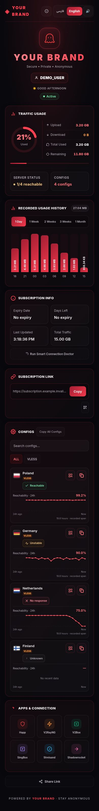
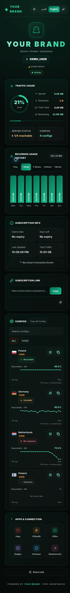
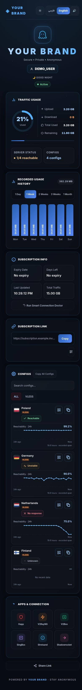

<div align="center">

# 👻 Ghost Sub

### Premium Subscription Page Template

#### 3X-UI · Pasarguard · Marzban


یه دستور. پنلت. تمت. اسم برندت.

</div>

صفحهٔ اشتراک برای **3X-UI، Marzban و Pasarguard**؛ با برند و لوگوی دلخواه، سه رنگ، فارسی/انگلیسی و چیدمان موبایل.


## پیش‌نمایش

این تصاویر از قالب جدید گرفته شده‌اند. نام کاربر، لینک‌ها، مصرف و وضعیت سرورها **همگی دادهٔ نمونه** هستند. در نصب واقعی، نام `YOUR BRAND` با انتخاب مدیر جایگزین می‌شود.

| قرمز | سبز | آبی |
|---|---|---|
|  |  |  |

## امکانات

- انتخاب برند، رنگ پیش‌فرض و نشان شبح، لوگوی PNG/JPG/WebP یا بدون نشان؛ حفظ تنظیمات در نصب بعدی.
- فارسی و انگلیسی، RTL، جستجو و فیلتر کانفیگ‌ها، کپی، QR و راهنمای اتصال اپ‌ها.
- پرچم SVG کنار کانفیگ‌ها؛ کشور ناشناخته با نشان عمومی نمایش داده می‌شود.
- مانیتور اختیاری دسترسی TCP با نمودار خطی ۲۴ ساعته و فاصله‌های خالی برای زمان فاقد داده.
- Usage Tracker قبلی Marzban/Pasarguard بدون تغییر فایل‌های سرویس.
- تاریخچهٔ اختیاری ثنایی با collector جدا؛ بر پایهٔ اختلاف شمارنده‌های API از زمان شروع جمع‌آوری.
- منوی مدیریت نصب، ظاهر، سرویس‌های اختیاری، بررسی محلی و بازگردانی بکاپ قالب.

## نصب و منوی مدیریت

نصب را روی همان سروری انجام دهید که پنل روی آن نصب شده است. به Python 3، Bash و curl نیاز دارید؛ مدیریت سرویس‌ها برای Linux با systemd در نظر گرفته شده است. اگر روی Ubuntu/Debian این ابزارها نصب نیستند:

```bash
apt update
apt install -y ca-certificates curl python3
```

سپس از طریق SSH با کاربر root وارد سرور پنل شوید.

با همان دستور قبلی، با کاربر root اجرا کنید:

```bash
bash <(curl -fsSL https://raw.githubusercontent.com/YASIN0ASADI/ghost-sub/main/install.sh)
```

نصاب فایل‌های کامل نسخهٔ فعلی را دریافت و منوی مدیریت را باز می‌کند. ورود به منو به‌تنهایی قالب یا سرویس پنل را restart نمی‌کند؛ عملیات را از منو انتخاب می‌کنید. دفعه‌های بعد برای بازکردن منوی نصب‌شده:

```bash
ghost-sub
```

| گزینه | کار |
|---|---|
| ۱ | نصب یا اعمال نسخهٔ قالب موجود در بسته |
| ۲ | تغییر برند، لوگو و رنگ با همان نصاب |
| ۳ | پیکربندی تاریخچهٔ اختیاری ثنایی |
| ۴ | پیکربندی مانیتور سرورها با مقصدهای ثابت |
| ۵ | بررسی محلی و فقط خواندنی |
| ۶ | بازگردانی بکاپ مشخص همان پنل |
| ۷ | اتصال نمودار به همان لینک اصلی ساب؛ بدون تغییر آدرس |

نصب ظاهر قبل از جایگزینی قالب بکاپ خصوصی می‌گیرد و پس از تأیید، پنل انتخاب‌شده را restart می‌کند؛ برای کاربران فعال زمان مناسب انتخاب کنید.

برای دریافت به‌روزرسانی، همان دستور تک‌خطی را دوباره اجرا کنید؛ سپس گزینهٔ نصب/اعمال قالب را انتخاب کنید. تنظیمات ذخیره‌شده با Enter حفظ می‌شوند.

## راهنمای گام‌به‌گام ظاهر و عکس پروفایل

۱. دستور تک‌خطی نصب را اجرا کنید و در منو گزینهٔ۱ برای نصب، یا گزینهٔ۲ برای تغییر ظاهر را انتخاب کنید.

۲. نوع پنل را انتخاب کنید: `1` ثنایی، `2` پاسارگارد، `3` مرزبان. سپس نام برند و رنگ پیش‌فرض را بدهید. رنگ‌ها: `1` قرمز، `2` سبز، `3` آبی. در نصب بعدی Enter تنظیمات ذخیره‌شده را حفظ می‌کند؛ در اولین ارتقا از قالب قدیمی نام برند را دوباره وارد کنید.

۳. در سؤال `Image address or choice` می‌توانید مستقیماً مسیر فایل **روی سرور** یا لینک HTTPS عکس را بدهید:

```text
/root/ghost-profile.jpg
```

یا لینک مستقیم HTTPS که خود تصویر را برمی‌گرداند؛ لینک صفحهٔ اشتراک عکس یا صفحهٔ HTML قابل استفاده نیست. همچنین `1` برای Ghost، `2` برای پرسیدن آدرس عکس و `3` برای حذف نشان قابل انتخاب است. Enter لوگوی ذخیره‌شده را حفظ می‌کند؛ در نصب اولیه Ghost پیش‌فرض است.

۴. برای عکس شخصی، قاب را انتخاب کنید: `1` گرد، `2` مربع با گوشه‌های گرد. تصویر جای Ghost در بالای صفحه قرار می‌گیرد. عکس درون HTML جاسازی می‌شود و مسیر asset عمومی جدید لازم نیست. PNG، JPG/JPEG و WebP تا ۲۵۶ کیبی‌بایت و عرض/ارتفاع حداکثر ۲۰۴۸ پیکسل پذیرفته می‌شوند. عوض‌کردن پسوند، فرمت عکس را تبدیل نمی‌کند؛ محتوای فایل بررسی می‌شود. تصاویر مربعی و بدون حاشیه برای قاب پروفایل مناسب‌ترند.

### انتقال عکس از ویندوز به سرور

مسیر ویندوز مانند `C:\Users\...` روی سرور لینوکسی وجود ندارد. ابتدا فایل را با SCP منتقل کنید. دستورهای این قسمت در **PowerShell ویندوز** اجرا می‌شوند.

برای دیدن نام دقیق عکس‌ها در پوشهٔ Telegram Desktop:

```powershell
Get-ChildItem "$env:USERPROFILE\Downloads\Telegram Desktop" -File |
    Where-Object { $_.Extension -in '.jpg','.jpeg','.png','.webp' } |
    Select-Object Name, Length
```

نام کامل فایل را در دستور زیر جایگزین کنید؛ `SERVER_IP` هم آدرس سرور پنل است. گیومه‌ها برای مسیر دارای فاصله لازم‌اند:

```powershell
scp "$env:USERPROFILE\Downloads\Telegram Desktop\photo.jpg" root@SERVER_IP:/root/ghost-profile.jpg
```

اگر پورت SSH مثلاً ۲۲۲۲ است، حرف بزرگ `P` را اضافه کنید:

```powershell
scp -P 2222 "$env:USERPROFILE\Downloads\Telegram Desktop\photo.jpg" root@SERVER_IP:/root/ghost-profile.jpg
```

می‌توانید به‌جای تایپ نام فایل، پنجرهٔ انتخاب عکس باز کنید و پسوند اصلی را حفظ کنید:

```powershell
Add-Type -AssemblyName System.Windows.Forms
$picture = New-Object System.Windows.Forms.OpenFileDialog
$picture.Filter = "Profile image|*.jpg;*.jpeg;*.png;*.webp"
if ($picture.ShowDialog() -eq [System.Windows.Forms.DialogResult]::OK) {
    $remoteImage = "/root/ghost-profile" + [IO.Path]::GetExtension($picture.FileName).ToLowerInvariant()
    scp "$($picture.FileName)" "root@SERVER_IP:$remoteImage"
    if ($LASTEXITCODE -eq 0) { Write-Host "Image path for installer: $remoteImage" }
}
```

پس از انتقال، در **ترمینال سرور** وجود فایل را بررسی کنید:

```bash
ls -lh /root/ghost-profile.jpg
```

سپس همان مسیر `/root/ghost-profile.jpg` را در سؤال عکس نصاب بدهید. اگر فایل PNG یا WebP انتخاب کرده‌اید، پسوند مسیر را هم مطابق خروجی انتقال وارد کنید.

### سؤال‌های بعد از عکس

| سؤال نصاب | معنی | اگر این قابلیت را تنظیم نکرده‌اید |
|---|---|---|
| `Status feed` | مسیر یا URL دادهٔ مانیتور دسترسی سرورها؛ آدرس عکس نیست | Enter؛ بدون feed، وضعیت نامشخص می‌ماند |
| `History route` در ثنایی | مسیر همان‌مبدأ خروجی سرویس تاریخچه، مانند `/ghost-usage/` | Enter؛ نمودار تاریخچهٔ جدید غیرفعال می‌ماند |
| `Install and restart selected panel?` | تأیید جایگزینی قالب و restart پنل انتخاب‌شده | برای ادامه `y`؛ برای انصراف Enter |

Enter در تنظیمات اختیاری، مقدار ذخیره‌شدهٔ قبلی را نگه می‌دارد؛ برای حذف مقدار قبلی `off` وارد کنید. نصب عکس نیازمند راه‌اندازی هیچ‌کدام از این دو سرویس اختیاری نیست.

### خطاهای متداول عکس و انتقال

| پیام | علت و اقدام |
|---|---|
| `is not a regular file` | مسیر یک پوشه است؛ نام کامل فایل عکس را هم بعد از پوشه بنویسید. برای عکس از `scp -r` استفاده نکنید. |
| `No such file or directory` | نام/مسیر اشتباه است؛ با `Get-ChildItem` در ویندوز یا `ls` در سرور بررسی کنید. |
| `Connection closed` | اتصال SSH بسته شده؛ پورت، دسترسی SSH و پیام کامل اتصال را بررسی کنید. این پیام به‌تنهایی مشکل عکس یا پسوند را ثابت نمی‌کند. |
| `Permission denied` در SSH | نام کاربر، رمز/کلید و مجوز ورود را بررسی کنید. |
| `Logo file not found on this server` | عکس هنوز روی سرور نیست یا مسیر ویندوز وارد شده است. |
| پیام محدودیت حجم/ابعاد | عکس را به حداکثر ۲۵۶ کیبی‌بایت و ۲۰۴۸ پیکسل کاهش دهید. |

## تغییر ظاهر و به‌روزرسانی بعدی

برای تغییر عکس/برند روی همان نسخه `ghost-sub` را اجرا کنید و گزینهٔ۲ را بزنید. برای گرفتن کد جدید، دستور تک‌خطی نصب را دوباره اجرا کنید تا منو و فایل‌ها تازه شوند؛ سپس نصب/اعمال قالب را انتخاب کنید. فقط بازکردن منوی نصب‌شده کد جدید را از GitHub دریافت نمی‌کند. بعد از ذخیره، صفحهٔ ساب را بدون کش باز کنید یا در ویندوز Ctrl+F5 بزنید.

## نمودار روی همان لینک اصلی ساب — بدون دامنه

**آدرس، پورت و توکن اصلی ساب کاربران عوض نمی‌شود.** صفحهٔ ساب، دادهٔ مانیتور همان سرور را در پس‌زمینه دریافت می‌کند. پورت داده (پیش‌فرض `18090`) فقط JSON مانیتور ارائه می‌کند؛ صفحه یا لینک ساب دوم ایجاد نمی‌شود. Apache، Nginx، دامنهٔ مینی‌اپ و دیتابیس پنل تغییر نمی‌کنند.

روش فعلی برای ساب **HTTP روی همان سرور** است. اگر لینک اصلی HTTPS است، این گزینه پیش از تغییر متوقف می‌شود؛ برای آن حالت به خروجی مانیتور HTTPS معتبر نیاز است و مرورگر نباید به HTTP ناامن برگردد. دامنه شرط نصب HTTP نیست.

### نصب اول، قدم‌به‌قدم

۱. دستور تک‌خطی نصب را روی سرور پنل اجرا کنید. در منوی اصلی گزینهٔ۱ را انتخاب کنید. پنل، نام برند، رنگ و عکس را طبق راهنمای عکس بالا تنظیم کنید. `Status feed` و `History route` را فعلاً خالی بگذارید. تأیید نهایی نصب ظاهر `y` است و پنل انتخاب‌شده restart می‌شود.

۲. گزینهٔ۴ منو را بزنید. برای حالت خودکار Enter بزنید. `Probe label` صرفاً نام محل پایش است؛ Enter مقدار پیش‌فرض را نگه می‌دارد. **لینک اصلی ساب خود پنل** را در سؤال مخفی وارد کنید؛ لینک خصوصی است و نباید در چت یا تصویر عمومی منتشر شود.

۳. تعداد مقصدهای TCP شناسایی‌شده را ببینید. برای ذخیره، شروع مانیتور و اجرای هنگام بوت `y` یا `yes` بدهید؛ حروف بزرگ/کوچک تفاوتی ندارند.

۴. به سؤال `Connect the chart to the ORIGINAL subscription link now?` پاسخ `y` بدهید. پنل نصب‌شده را انتخاب کنید: `1` ثنایی، `2` پاسارگارد، `3` مرزبان. پورت دادهٔ مانیتور را با Enter روی `18090` نگه دارید، مگر اینکه آن پورت قبلاً در اختیار برنامهٔ دیگری باشد. این عدد پورت جدید ساب نیست.

۵. تأیید اتصال را `y` بزنید. قبل از تغییر، قالب فعلی و تنظیمات لازم در پوشهٔ خصوصی بکاپ می‌شوند. آدرس خروجی مانیتور و کد خواندن آن خودکار به همان قالب اضافه می‌شود. برای خواندن قالب تازه، فقط پنل انتخاب‌شده restart می‌شود؛ ممکن است اتصال کاربران آن پنل لحظه‌ای قطع شود.

۶. **همان لینک قبلی ساب** را در مرورگر باز کنید و Ctrl+F5 بزنید. آدرس مرورگر نباید تغییر کند؛ برای دیدن نمودار لینک جدیدی به کاربران ندهید. نام برند و عکس قبلی حفظ می‌شوند. ورود دستی `Status feed` لازم نیست.

### اگر مانیتور را قبلاً نصب کرده‌اید

دستور تک‌خطی را دوباره اجرا کنید تا کد منو تازه شود. از منوی اصلی مستقیماً **گزینهٔ۷: Attach chart to ORIGINAL subscription** را انتخاب کنید. لینک اصلی از تنظیمات خصوصی مانیتور خوانده می‌شود؛ اگر موجود نباشد یک‌بار در سؤال مخفی پرسیده می‌شود. سپس پنل را انتخاب کنید، برای پورت مانیتور Enter بزنید و اتصال را با `y` تأیید کنید. هدف‌ها، عکس و برند را دوباره تنظیم نکنید.

اگر نسخهٔ قبلی یک ورودی ساب جدا روی پورت ۱۸۰۹۰ ساخته بود، این مرحله همان سرویس را به خروجی صرفاً داده تبدیل می‌کند. آن آدرس دیگر صفحهٔ ساب نمی‌دهد؛ **از لینک اصلی پنل، مثلاً با پورت ۲۰۹۶، استفاده کنید.** توکن و پورت ساب در پنل تغییر نمی‌کنند.

### بررسی روی سرور

```bash
systemctl is-active ghost-status.service ghost-gateway.service
curl -fsS --max-time 5 http://127.0.0.1:19191/status.json
curl -fsS --max-time 5 http://127.0.0.1:18090/ghost-status.json
```

نام فنی سرویس داده برای حفظ سازگاری نسخهٔ قبلی `ghost-gateway.service` است؛ در حالت جدید فقط خروجی مانیتور را ارائه می‌کند. پورت ۱۹۱۹۱ داخلی می‌ماند و نباید در فایروال عمومی باز شود.

پورت **دادهٔ انتخاب‌شده** باید از مرورگر قابل دسترس باشد. اگر فایروال دارید، فقط همان پورت را در قواعد فعلی و پنل ارائه‌دهنده باز کنید. نصاب فایروال را خودکار دست‌کاری نمی‌کند. مثلاً فقط اگر UFW فعال است و پورت شما ۱۸۰۹۰ است:

```bash
ufw status
ufw allow 18090/tcp
```

برای این کار UFW غیرفعال را فعال نکنید و قواعد قبلی را reset نکنید. اگر فایروال دیگری دارید، همان‌جا پورت لازم را مجاز کنید.

### رفع مشکل نمودار

| نشانه | اقدام |
|---|---|
| `Unknown` یا نمودار خالی در شروع | بعد از اولین نمونه صفحه را تازه کنید؛ داده از زمان شروع جمع می‌شود |
| JSON داخلی پورت ۱۹۱۹۱ خطا می‌دهد | وضعیت و لاگ `ghost-status.service` را بررسی کنید |
| JSON پورت ۱۸۰۹۰ روی سرور کار می‌کند، در مرورگر نه | پورت داده و Origin را بررسی کنید؛ لینک اصلی واردشده در منو باید دقیقاً همان IP/نام و پورت لینک مرورگر باشد |
| قالب قدیمی در مرورگر مانده | Ctrl+F5 یا پنجرهٔ خصوصی؛ مطمئن شوید پنل انتخاب‌شده restart شده است |
| پورت داده اشغال است | در گزینهٔ۷ پورت آزاد دیگری انتخاب کنید |
| لینک قبلی ۱۸۰۹۰ خطای ۴۰۴ می‌دهد | این رفتار حالت داده است؛ لینک اصلی پنل را باز کنید |
| لینک اصلی HTTPS است | این روش HTTP به‌صورت خودکار اعمال نمی‌شود؛ از مسیر مانیتور HTTPS مطابق راهنمای فنی استفاده کنید |
| وضعیت `up` ولی اپ وصل نمی‌شود | بررسی فقط دسترسی TCP است و احراز هویت/کارکرد کامل پروتکل را اثبات نمی‌کند |

```bash
journalctl -u ghost-status.service -u ghost-gateway.service -n 40 --no-pager
```

لاگ را قبل از اشتراک‌گذاری از لینک/توکن خصوصی پاک کنید. برای توقف سرویس داده:

```bash
systemctl disable --now ghost-gateway.service
```

این توقف لینک اصلی ساب را از کار نمی‌اندازد؛ وضعیت نمودار پس از کهنه‌شدن داده نامشخص می‌شود. برای اتصال مجدد گزینهٔ۷ را اجرا کنید. بازگردانی قالب از بکاپ، در گزینهٔ۶ منو توضیح داده شده است.

## شناسایی خودکار کانفیگ‌ها برای مانیتور

در منوی `ghost-sub` گزینهٔ۴ را بزنید. حالت `1` (پیش‌فرض) همهٔ مقصدهای TCP یک لینک ساب را وارد می‌کند؛ حالت `2` برای ورود دستی است. یک نام دلخواه برای محل پایش بدهید یا Enter بزنید. لینک کامل ساب خودتان را در سؤال مخفی وارد کنید؛ آن را در چت، اسکرین‌شات یا GitHub قرار ندهید.

لینک‌های خام یا Base64 شامل VLESS، Trojan، VMess و Shadowsocks و قالب HTML همین Ghost Sub پشتیبانی می‌شوند. مقصدهای تکراری یکی می‌شوند؛ حداکثر ۶۴ مقصد TCP پشتیبانی می‌شود. QUIC/KCP با تست TCP سنجیده نمی‌شوند. فقط کانفیگ‌های موجود در همان لینک ساب خوانده می‌شوند، نه تمام کاربران پنل.

پس از تأیید ذخیره و start سرویس، دسترسی مقصدها هر ۶۰ ثانیه سنجیده می‌شود و فهرست کانفیگ‌ها هر ۱۵ دقیقه از همان ساب تازه می‌شود؛ افزودن/حذف کانفیگ در آن ساب نیاز به ورود دستی جداگانه ندارد. اگر دریافت ساب موقتاً ناموفق شود، آخرین فهرست حفظ می‌شود. در شروع مجدد سرویس، فهرست دوباره از ساب خوانده می‌شود.

لینک ساب در تنظیمات خصوصی سرور ذخیره می‌شود و در JSON عمومی مانیتور نمایش داده نمی‌شود. برای HTTP لینک بدون رمزگذاری منتقل می‌شود؛ HTTPS را ترجیح دهید. برای اتصال به همان لینک اصلی ساب HTTP از گزینهٔ۷ استفاده کنید؛ روش reverse proxy برای ورودی HTTPS موجود به‌صورت اختیاری در [راهنمای مانیتور](docs/STATUS_MONITOR_FA.md) آمده است.

## نمودارها و سرویس‌های اختیاری

| بخش | منبع داده | راهنما |
|---|---|---|
| مصرف فعلی | مقادیر خود پنل در قالب | نیازمند فعال‌بودن صفحهٔ ساب پنل |
| تاریخچهٔ Marzban/Pasarguard | Tracker قبلی یا fallback موجود مرورگر | جریان نصب قبلی حفظ شده است |
| تاریخچهٔ 3X-UI | collector جدا با دسترسی API سمت سرور | [راهنمای ثنایی](docs/3XUI_HISTORY_FA.md) |
| نمودار دسترسی سرورها | نمونه‌برداری TCP از سرور مانیتور | [راهنمای مانیتور](docs/STATUS_MONITOR_FA.md) |

نصب قالب به‌تنهایی پایش یا تاریخچه را فعال نمی‌کند. برای سرویس‌های جدید، پیکربندی، start و فعال‌سازی هنگام بوت انتخاب‌های جدا هستند؛ گزینهٔ۷ خواندن دادهٔ مانیتور را در پس‌زمینهٔ همان صفحهٔ ساب HTTP فعال می‌کند؛ reverse proxy فقط برای استفاده از ورودی وب موجود، انتخابی جدا است.

وضعیت TCP سلامت کامل کانفیگ یا آپ‌تایم سیستم‌عامل را اثبات نمی‌کند. بدون دادهٔ تازه، وضعیت نامشخص است. تاریخچهٔ ثنایی دادهٔ پیش از نصب را بازسازی نمی‌کند و جایگزین آمار صورتحساب پنل نیست. رمز یا API token پنل را داخل HTML، مخزن یا تصویر قرار ندهید.

## فعال‌سازی قالب در پنل

### 3X-UI

در تنظیمات Subscription، مسیر Sub Theme Directory را روی این پوشه قرار دهید:

```text
/etc/3x-ui/sub_templates/my-theme/
```

### Marzban و Pasarguard

طبق روش نصب پنل، این تنظیمات را در فایل env آن قرار دهید:

```dotenv
CUSTOM_TEMPLATES_DIRECTORY="/var/lib/marzban/templates/"
SUBSCRIPTION_PAGE_TEMPLATE="subscription/index.html"
```

برای Pasarguard مسیر پایه را به `/var/lib/pasarguard/templates/` تغییر دهید و گزینهٔ غیرفعال‌کردن Subscription Template را خاموش کنید. مسیر mount در نصب‌های Docker باید با تنظیمات پنل مطابقت داشته باشد.

## بکاپ و بازگردانی

قالب و manifest قبلی در `/root/ghost-sub-backup.*` ذخیره می‌شوند؛ داخل پوشهٔ عمومی ساب قرار نمی‌گیرند. گزینهٔ۶ منو بکاپ‌های جدید دارای مشخصات همان پنل را بازمی‌گرداند و از وضعیت فعلی هم نسخهٔ بازیابی می‌گیرد. بکاپ‌های قدیمی بدون مشخصات، بررسی دستی می‌خواهند. این قابلیت بازگردانی کل سیستم، دیتابیس یا تنظیمات سرویس‌ها نیست.

## ساختار

```text
sub.html / marzban.html / pasarguard.html
install.sh / manifest.json
scripts/          ابزارهای نصب و مدیریت
docs/             راهنماهای فنی
tracker/          Tracker قبلی
traffic-history/    تاریخچهٔ اختیاری ثنایی
status-monitor/   پایش اختیاری TCP
screenshots/      تصاویر جدید
gateway/          سرویس دادهٔ مانیتور برای لینک اصلی ساب
```

طراحی و توسعه: [YASIN0ASADI / Invincible](https://github.com/YASIN0ASADI) · [Telegram](https://t.me/Inv1n3ible)
